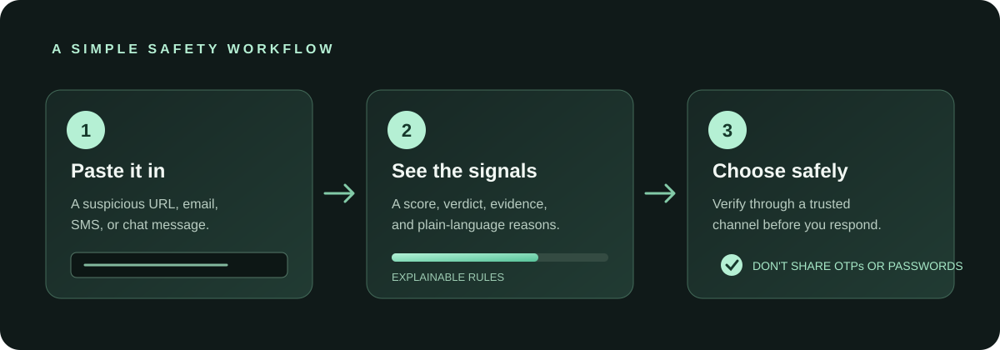
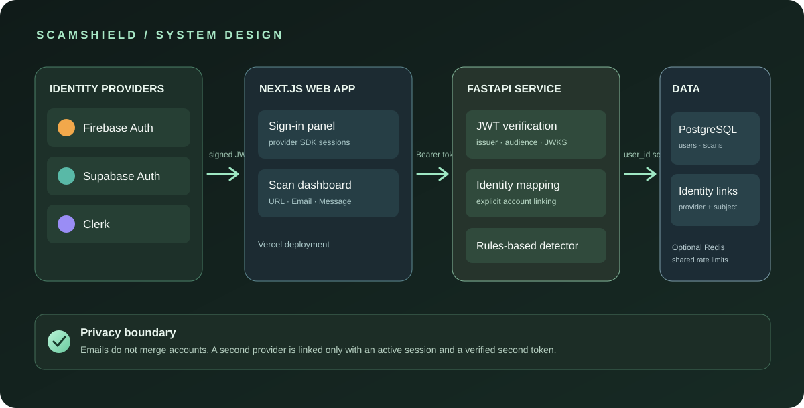

# ScamShield

  

  
  
  
  
  

**ScamShield** is an explainable scam and phishing checker for suspicious links, emails, SMS, and messages. It highlights warning signs, gives a transparent risk score, and suggests a safer next step.

> ScamShield is a decision-support tool, not a guarantee. A “Safe” result does not prove a message, sender, website, or payment request is legitimate.

## What it does

- **Analyze:** inspect URLs, emails, and messages with a deterministic rules engine.
- **Explain:** show the signals and evidence behind each result.
- **Authenticate:** sign in with Firebase Authentication, Supabase Auth, or Clerk.
- **Link accounts:** connect more than one provider to the same ScamShield profile after authenticating both accounts.
- **Keep data private:** saved scans, history, statistics, and reports are scoped to the signed-in ScamShield user.
- **Deploy separately:** Next.js frontend on Vercel; FastAPI API and PostgreSQL on a Python-capable host such as Render.

## Product overview

  

## Architecture

  

The browser obtains an identity token from the selected provider. FastAPI verifies its signature and claims against that provider's public signing keys, then maps the provider subject to an internal ScamShield user ID. The database stores that user ID with each scan and report.

**Email addresses are never used to merge accounts.** A second provider is linked only while an existing ScamShield session is active and the second provider has also authenticated successfully. If a provider identity already belongs to another ScamShield account, linking is rejected.

## Tech stack

| Layer | Technology |
| --- | --- |
| Web application | Next.js 16, React 19, TypeScript |
| API | FastAPI, Pydantic |
| Detection | Explainable Python rules engine |
| Authentication | Firebase Auth, Supabase Auth, Clerk |
| Identity verification | PyJWT + provider JWKS |
| Persistence | SQLAlchemy, PostgreSQL in hosted deployments |
| Rate limiting | Redis-backed when REDIS_URL is configured |
| Hosting | Vercel frontend, Render API blueprint |
| Automation | GitHub Actions CI + CodeQL |

## Authentication setup

All three providers are supported by one backend identity layer. Configure only the providers that should be enabled. The frontend sign-in panel loads the provider browser SDKs on demand from their vendor CDNs; a provider needs its own public browser configuration and backend verification settings. Firebase and Supabase are configured for Google OAuth in this starter UI; Clerk uses the sign-in methods enabled in its dashboard.

### 1. Firebase Authentication

1. Create or open a Firebase project.
2. Enable **Authentication → Sign-in method → Google**.
3. Add the deployed frontend domain to **Authentication → Settings → Authorized domains**.
4. Copy the Web App API key, Auth domain, and Project ID into the frontend environment.
5. Set FIREBASE_PROJECT_ID in the backend to the same Project ID.

Firebase ID tokens are verified against Google's Secure Token signing keys, the Firebase issuer, and the project audience.

### 2. Supabase Auth

1. Create or open a Supabase project.
2. Enable Google under **Authentication → Providers** and configure the OAuth client.
3. Add the local and deployed frontend URLs to the Supabase redirect URL allowlist.
4. Set the Supabase project URL and anon/publishable key in the frontend.
5. Set SUPABASE_URL in the backend to the same project URL.
6. Use an asymmetric JWT signing key (RS256 or ES256) so the API can verify tokens using the project's JWKS endpoint.

The Supabase anon/publishable key is intended for browser use. Never put the service-role key in the frontend.

### 3. Clerk

1. Create or open a Clerk application.
2. Enable the sign-in methods required by the product.
3. Add local and deployed frontend origins to the Clerk allowed origins/redirect settings.
4. Set the Clerk publishable key in the frontend.
5. Read the exact iss claim from a Clerk session token and set it as CLERK_ISSUER.
6. Set CLERK_JWKS_URL to that Clerk instance's /.well-known/jwks.json endpoint.

The backend checks the token issuer and signature against the configured Clerk JWKS. Do not use a secret key in browser configuration.

### Frontend environment variables

Set these in Vercel → Project → Settings → Environment Variables (and in .env.local for local development):

| Variable | Purpose |
| --- | --- |
| NEXT_PUBLIC_API_URL | Public HTTPS URL of the FastAPI service |
| NEXT_PUBLIC_FIREBASE_API_KEY | Firebase Web App API key |
| NEXT_PUBLIC_FIREBASE_AUTH_DOMAIN | Firebase Auth domain |
| NEXT_PUBLIC_FIREBASE_PROJECT_ID | Firebase project ID |
| NEXT_PUBLIC_SUPABASE_URL | Supabase project URL |
| NEXT_PUBLIC_SUPABASE_ANON_KEY | Supabase anon/publishable key |
| NEXT_PUBLIC_CLERK_PUBLISHABLE_KEY | Clerk publishable key |

### Backend environment variables

Set these on the API host. These are not NEXT_PUBLIC_ variables:

| Variable | Purpose |
| --- | --- |
| FIREBASE_PROJECT_ID | Enables Firebase token verification |
| SUPABASE_URL | Enables Supabase token verification and JWKS lookup |
| CLERK_ISSUER | Exact issuer (iss) expected in Clerk tokens |
| CLERK_JWKS_URL | Clerk public signing-key endpoint |
| DATABASE_URL | PostgreSQL connection string in production |
| CORS_ORIGINS | Exact frontend origins, comma-separated |
| REDIS_URL | Optional shared rate-limit store |
| OPENAI_API_KEY | Optional server-only explanation key |

Copy .env.example as a starting point. Never commit real credentials. Browser API keys and publishable/anon keys are public by design; provider secret keys, service-role keys, database passwords, and OpenAI keys must remain server-side.

## Local development

### Requirements

- Node.js 20.9+
- Python 3.12+
- Git

### Start the API

From the repository root:

~~~bash
cd backend
python -m venv .venv
# Windows PowerShell:
.venv\Scripts\Activate.ps1
# macOS/Linux:
source .venv/bin/activate
pip install -r requirements.txt
uvicorn app.main:app --reload --port 8000
~~~

### Start the frontend

In a second terminal at the repository root:

~~~bash
npm ci
npm run dev
~~~

Open http://localhost:3000. Set NEXT_PUBLIC_API_URL=http://localhost:8000 in .env.local to connect the dashboard to the local API.

### Run checks

~~~bash
npm run typecheck
npm run build
python -m pytest backend/tests -q
~~~

## API routes

| Method | Route | Access |
| --- | --- | --- |
| GET | /health | Public |
| GET | /metrics | Public, process-local counters |
| GET | /api/v1/auth/providers | Public, lists configured providers |
| POST | /api/v1/auth/session | Valid provider bearer token |
| POST | /api/v1/auth/link | Signed-in user + second provider token |
| POST | /api/v1/analyze | Public scan; only authenticated scans are saved |
| GET | /api/v1/history | Authenticated, current user only |
| GET | /api/v1/stats | Authenticated, current user only |
| GET | /api/v1/test-cases | Public |
| POST | /api/v1/reports | Authenticated, current user only |

Interactive API documentation is available at /docs on the running FastAPI service.

## Deployment

### API on Render

The repository includes render.yaml for a FastAPI Docker service and managed PostgreSQL. Review the plan and estimated charges in Render before applying the blueprint.

1. Apply the Render Blueprint from this repository.
2. Set the backend provider variables for every authentication provider being enabled.
3. Set CORS_ORIGINS to the exact Vercel production origin.
4. Copy the deployed API HTTPS URL.

### Frontend on Vercel

1. Import this GitHub repository into Vercel.
2. Add NEXT_PUBLIC_API_URL with the deployed API URL.
3. Add the public Firebase, Supabase, and Clerk variables for the providers being enabled.
4. Redeploy the frontend after adding or changing environment variables.

The Render blueprint does not create a Vercel project or configure third-party identity-provider dashboards. Those steps require access to the relevant accounts.

## Detection limits and privacy

- The current detector is a deterministic heuristic baseline, not a trained ML model.
- URL inspection is lexical; ScamShield does not visit submitted URLs or claim live domain reputation.
- A result can be wrong. Verify urgent payment, password, and account requests through a trusted channel.
- Scans can be analyzed without an account, but anonymous scans are not persisted.
- Saved history, statistics, and reports require a verified provider identity and are isolated by internal user ID.
- Linking providers requires a current authenticated session plus a second valid provider token. Matching email addresses do not trigger account merging.
- Optional OpenAI explanations are disabled by default. If enabled, submitted content may be sent to OpenAI; disclose this clearly before enabling the feature for real users.
- Use HTTPS, restrict CORS to exact origins, rotate exposed secrets, and review provider redirect settings before launch.

## Repository layout

~~~text
app/                    Next.js dashboard and sign-in panel
backend/app/            FastAPI routes, auth, detector, and repository
backend/tests/          API, detector, and persistence tests
docs/                   Architecture and product SVG artwork
lib/                    Frontend API client and local fallback detector
scripts/                Repository structure validation
.github/workflows/      CI and CodeQL automation
render.yaml             Render API + PostgreSQL blueprint
~~~

## Roadmap

- Calibrated ML/NLP detector with a published evaluation set
- URL reputation integrations behind an isolated, safe worker
- Passwordless and passkey options across identity providers
- Account recovery and a dedicated account-management screen
- Database migrations, audit events, and operational monitoring
- Browser extension and user-consented email ingestion

## License

See [LICENSE](LICENSE).
